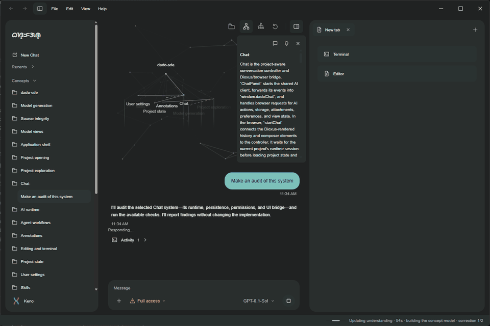

  <picture>
    <source media="(prefers-color-scheme: dark)" srcset="./assets/readme/wordmark-white.png">
    <source media="(prefers-color-scheme: light)" srcset="./assets/readme/wordmark-dark.png">
    
  </picture>
  <h1>Baskagan SDE</h1>
  
<strong>Make the bigger picture visible while you build.</strong>

  

    
    
    
    
  

  

Baskagan SDE makes a codebase explorable as a system. It turns project sources into a navigable model of concepts and relationships, then keeps that model close while you inspect, discuss, annotate, and change code. At any point, you can see where the part you’re working on fits into the whole and follow its connections back to source.

## Keep the project’s context within reach

In a long conversation, the context behind a question can get buried in the scroll. SDE keeps the system map and its source connections close by, making it easier to see how the conversation fits into the work as a whole.

## What you can do

- **Explore how the project fits together.** Move from purpose through responsibilities to implementation, and follow relationships between concepts.
- **Trace ideas to source.** Open the file or exact code range behind a concept.
- **Bring focused context into chat.** Discuss a selected concept with its relationships and references, alongside open editor snapshots.
- **Carry understanding into the work.** Annotate code, review proposed text edits as diffs, and continue in the integrated editor and project-root terminal.

## Start

On Windows, install the Microsoft C++ build tools and WebView2 Runtime, then run:

    cargo run

To open a project folder on launch:

    cargo run -- "C:/path/to/project"

The editor and terminal assets are checked in, so running the app does not require Node.js or network access. See the [development guide](docs/DEVELOPMENT.md) for build and quality-check instructions.

## Guides

- [User guide](docs/USER_GUIDE.md) — systems navigation, concepts, workspace, annotations, and settings
- [AI and agent workflows](docs/AI_AND_AGENT_WORKFLOWS.md) — model context, permissions, review, provenance, and skills
- [Development guide](docs/DEVELOPMENT.md) — build, tests, and implementation notes
- [GitHub setup](docs/GITHUB_SETUP.md) — contribution templates, quality checks, and branch rules

## Contributing

Bug reports, focused improvements, and documentation updates are welcome. Read [CONTRIBUTING.md](CONTRIBUTING.md) before opening a pull request. For security issues, follow [SECURITY.md](SECURITY.md) and report them privately.
